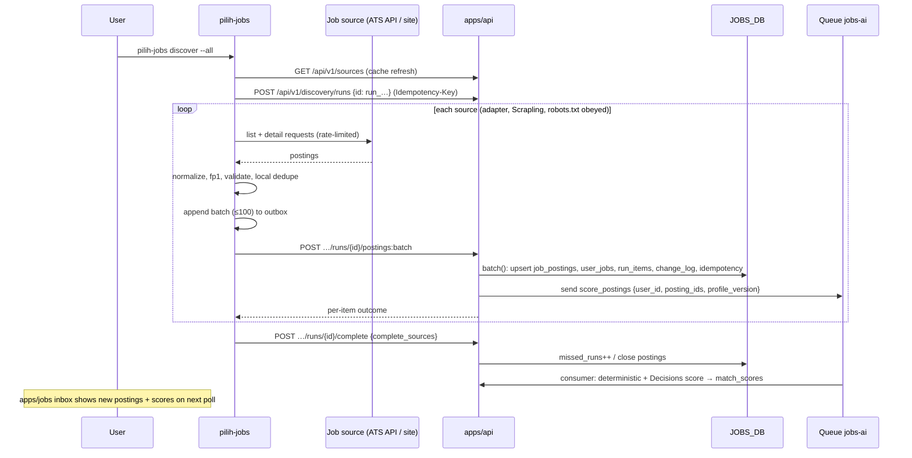
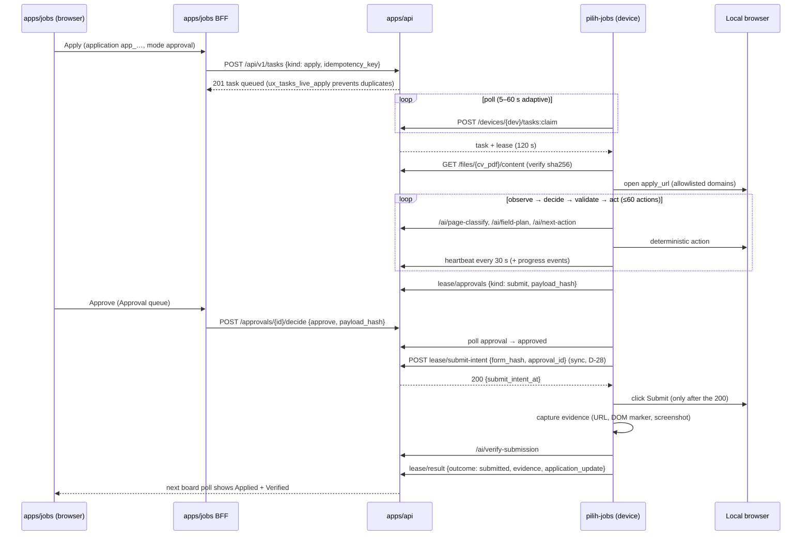

# 02 — System Architecture

This document is the end-to-end architecture of the Job Tracker. It covers:
- what runs where;
- which component owns which data and how much each is trusted;
- the repository layout after the change;
- how the Python CLI and the TypeScript backend share one contract;
- the main data flows;
- deployment and failure behaviour.

Service selection is justified in 14. Wire contracts are in 05.

Legend: see `00-README.md` §2.

---

## 1. Architecture diagram

Only services actually adopted in v1 are drawn. Rejected or deferred services
(Workflows, new Durable Objects, Browser Rendering, Workers AI) are listed in 14.

```text
┌──────────────────────────── USER'S LOCAL MACHINE (macOS / Windows / Linux) ─────────────────────────────┐
│                                                                                                         │
│  pilih-jobs  (apps/jobs-cli · Python 3.12 · uv)                                         [NEW] D-07/D-08 │
│  ┌───────────────┐  ┌──────────────────────┐  ┌──────────────────────┐  ┌──────────────────────────┐    │
│  │ Auth          │  │ Discovery Manager    │  │ Automation Worker    │  │ Sync Client              │    │
│  │ OAuth+PKCE    │  │ ├ Adapter Registry   │  │ ├ Task poller/lease  │  │ ├ Outbox (SQLite)        │    │
│  │ loopback      │  │ ├ ScraplingJobEngine │  │ ├ Browser Controller │  │ ├ Change-feed puller     │    │
│  │ keyring       │  │ │  (scrapling 0.4.15)│  │ │  (Playwright 1.63)  │  │ └ Idempotent HTTP (httpx)│    │
│  │ device reg.   │  │ ├ Normalizer + fp1   │  │ ├ Agent orchestrator │  └────────────┬─────────────┘    │
│  └──────┬────────┘  │ └ Dedupe/validate    │  │ ├ Deterministic exec │               │                  │
│         │           └──────────┬───────────┘  │ ├ CV/attachment mgr  │               │                  │
│         │                      │              │ └ Evidence capture   │               │                  │
│         │                      │              └──────────┬───────────┘               │                  │
│  Local state (never authoritative): state.db (outbox, cache, checkpoints), browser-profiles/,          │
│  scrapling/adaptive.db, runs/<att_id>/ (staging, logs), OS keychain (refresh token)                    │
│  Chromium (ms-playwright cache) · optional user Chrome on a dedicated debug profile (mode B, D-23)      │
└─────────┼──────────────────────┼─────────────────────────┼───────────────────────────┼──────────────────┘
          │ HTTPS · Bearer (OAuth access token, 1 h, device-bound)                     │
          ▼                      ▼                         ▼                           ▼
┌─────────────────────────────────────────── CLOUDFLARE ────────────────────────────────────────────────┐
│                                                                                                       │
│  api-pilihpendidikan  (apps/api · api.pilihpendidikan.com)                          [VERIFIED]+[NEW]  │
│  ┌───────────────────────────────────────────────────────────────────────────────────────────────┐    │
│  │ existing: /auth/* · /connect · /oauth/* (extended, 17) · /mcp,/sse (PilihMcpServer DO)          │    │
│  │ new: /api/v1/* → src/jobs/routes → services → repo (only module touching JOBS_DB, 04 §5)       │    │
│  │      src/jobs/ai (OpenAI Decisions + Responses, store:false)   src/jobs/queue (consumer)       │    │
│  │ legacy facade: /api/jobs + jobs_* MCP tools over JOBS_DB (D-04)                                │    │
│  └──────┬─────────────────┬──────────────────┬───────────────────┬──────────────────┬──────────┘    │
│         │                 │                  │                   │                  │               │
│   ┌─────▼─────┐     ┌─────▼─────────┐  ┌─────▼─────┐      ┌──────▼──────┐    ┌──────▼──────────┐    │
│   │ D1 DB     │     │ D1 JOBS_DB    │  │ R2        │      │ Queue       │    │ KV (existing)   │    │
│   │ users,    │     │ pilihpendidik-│  │ JOBS_FILES│      │ jobs-ai     │    │ AUTH_KV, CV_KV, │    │
│   │ mcp_tokens│     │ an-jobs (all  │  │ CV PDFs,  │      │ + DLQ       │    │ RATE_LIMIT_KV,  │    │
│   │ oauth_*,  │     │ job tracker   │  │ letters,  │      │ jobs-ai-dlq │    │ JOBS_KV (legacy,│    │
│   │ devices   │     │ records)      │  │ evidence  │      │             │    │ read-only→retire│    │
│   └───────────┘     └───────────────┘  └───────────┘      └─────────────┘    └─────────────────┘    │
│   Cron: 0 3 * * * (existing purge + daily jobs) · */5 * * * * (leases, approvals, expiry)            │
│   send_email EMAIL (existing; email applications only if A-03)                                       │
│                                                     ▲ service binding `API` (D-15)                   │
│  jobs-pilihpendidikan (apps/jobs · jobs.pilihpendidikan.com)                               [NEW]     │
│  TanStack Start SSR + BFF server functions · __Host-jobs-session cookie · /render/cv/$cvvId route    │
└──────────────────────────────────────────────────────┬────────────────────────────────────────────────┘
                                                       │ HTTPS (cookie)
                                                       ▼
                                    Browser: apps/jobs dashboard (Zedative, D-24)
             Board · Inbox · Application detail · Approvals · Automation · Devices · Stats · Profile

External: api.openai.com (/v1/decisions, /v1/responses) — called ONLY by apps/api (D-12)
          ATS public APIs and career pages — called ONLY by the CLI (D-16)
```

---

## 2. Component boundaries

| Component | Responsibility | Owns durable data? | Runtime | Trust level |
|---|---|---|---|---|
| `apps/jobs` browser UI | Rendering, user intent, approvals UI, PDF rendering for variants (D-14) | No | Browser (React 19) | Untrusted client; every input is revalidated by the API |
| `apps/jobs` Worker (BFF) | SSR; session cookie ↔ bearer mapping; server functions proxying to `API` | No (session handle only) | Workers | Trusted first-party; holds a user bearer server-side |
| `apps/api` Worker | AuthN/AuthZ, validation, state machines, leases, idempotency, AI proxy, queue producer and consumer, crons | Yes, sole writer of `DB`, `JOBS_DB`, `JOBS_FILES`, `CV_KV` | Workers | Trusted. The only component that holds `OPENAI_API_KEY` |
| `PilihMcpServer` DO (existing) | MCP transport, calls the same services | No (session state only) | Durable Object | Trusted |
| D1 `DB` | Identity, credentials, devices | — | — | Trusted store |
| D1 `JOBS_DB` | All Job Tracker records | — | — | Trusted store; isolation enforced in the repository layer |
| R2 `JOBS_FILES` | Binary artifacts | — | — | Trusted store; private bucket, no public access, no presigned URLs |
| Queue `jobs-ai` | Durable async AI work | Transient | — | Trusted |
| `pilih-jobs` CLI | Discovery, browser automation, attachments, outbox | **No.** Caches only (D-07) | Python 3.12 on the user's machine | **Semi-trusted.** Acts as the user but may be outdated, compromised or offline. The server re-checks every claim (fingerprints, transitions, leases, hashes) |
| Local browser | Rendering third-party sites, user's ATS sessions | Profiles stay local | Chromium / Chrome | **Untrusted content.** DOM and screenshots are data, never instructions (19 §10) |
| OpenAI | Classification, choice, structured generation | No (`store: false`, D-12) | External | Untrusted output; Zod-validated, policy-gated |
| Job sources (ATS, career sites) | Postings | No | External | Untrusted input; schema-validated, size-capped |

**Hard boundary rules**

1. Only `apps/api/src/jobs/repo/*` touches `JOBS_DB` (04 §5).
2. Only `apps/api/src/jobs/ai/*` calls OpenAI.
3. Only the CLI fetches third-party job sites. The Worker never scrapes:
   that would move execution off-device and expose Cloudflare IPs to source
   bot rules.
4. Only the CLI drives browsers for applications. Cloudflare never contacts
   the user's machine; the CLI polls (D-11).
5. Browser cookies, profile directories and keychain secrets never leave the
   machine (C-10).

---

## 3. Repository layout after the change

```text
pilihpendidikan/
├── apps/
│   ├── api/                              [VERIFIED] existing Worker, extended
│   │   ├── migrations/0002_users_devices_oauth.sql        [NEW] (04 §1)
│   │   ├── migrations-jobs/0001_jobs_core.sql             [NEW] (04 §2)
│   │   └── src/
│   │       ├── oauth/                    extended: refresh, revoke, scopes, loopback (17)
│   │       ├── jobs/                     [NEW]
│   │       │   ├── routes/               /api/v1/* handlers (05)
│   │       │   ├── services/             applications, discovery, tasks, approvals, cv-variants, files, analytics
│   │       │   ├── repo/                 the only JOBS_DB access (UserScope-branded)
│   │       │   ├── ai/                   provider interface, openai-decisions.ts, openai-responses.ts, prompts/
│   │       │   ├── queue/                consumer.ts, messages.ts (14 §6)
│   │       │   ├── cron/                 lease-reaper, approval-expiry, retention, rollup (14 §7)
│   │       │   └── legacy/               /api/jobs + jobs_* MCP facade (D-04)
│   │       └── tools/jobs*.ts            MCP tools re-pointed to services
│   ├── jobs/                             [NEW] TanStack Start dashboard (port 4007)
│   │   ├── src/routes/                   index (board), inbox, applications.$id, approvals, automation, devices, stats, profile, render.cv.$cvvId, id.tsx (sets locale + redirects, D-27)
│   │   ├── src/server/                   BFF server functions, session cookie
│   │   └── wrangler.jsonc                service binding API
│   ├── jobs-cli/                         [NEW] Python package (16)
│   │   ├── pyproject.toml  uv.lock  package.json (turbo shim)
│   │   ├── src/pilih_jobs/               cli/, auth/, sync/, discovery/, browser/, agent/, tasks/, models/ (generated), storage/
│   │   └── tests/
│   ├── cv/                               [NEW] imports packages/cv-engine instead of local copies
│   ├── home/                             adds `jobs` to services.ts ("soon" until going live)
│   └── invoice/, portfolio/, design/     unchanged
├── packages/
│   ├── ui/                               [VERIFIED] @rulisme/ui (Zedative theme)
│   ├── config/                           [VERIFIED]
│   ├── jobs-contracts/                   [NEW] Zod schemas → JSON Schema → Pydantic (D-20)
│   │   ├── src/*.ts  schema/*.json (generated)  adapters.json  test-vectors/
│   └── cv-engine/                        [NEW] CVData types, 4 *-pdf templates, template-utils, formatCvMarkdown (D-14)
├── job-tracker-spec/                     this specification
└── openspec/changes/<jobs-*>             one change per milestone (13 §2)
```

---

## 4. Python ↔ TypeScript integration

### 4.1 Contract pipeline (D-20)

```text
packages/jobs-contracts/src/*.ts  (Zod v4 — catalog version ^4.6.5 [VERIFIED] root package.json)
        │  bun run contracts:build  →  z.toJSONSchema() per exported schema
        ▼
packages/jobs-contracts/schema/*.json   (committed; reviewed in PRs)
        │                                      │
        │ imported by apps/api, apps/jobs      │ uv run datamodel-codegen --input-file-type jsonschema
        ▼                                      ▼    --output-model-type pydantic_v2.BaseModel
TypeScript types (z.infer)            apps/jobs-cli/src/pilih_jobs/contracts/_generated/*.py  (committed)
```

- **Drift guard:** `bun run contracts:check` regenerates both outputs and fails
  if `git diff --exit-code` shows changes. It runs in `bun run check`.
- **Shared test vectors:** `test-vectors/fingerprint.json`,
  `canonical-url.json`, `stage-transitions.json`. These are executed by
  `bun test` in `apps/api` and by `pytest` in `apps/jobs-cli`, so both
  languages implement fp1 and the stage machine identically.
- **Adapter manifest:** `adapters.json` (ids, capabilities, config JSON Schema,
  restrictions). It is read by the CLI registry (validation), the API
  (`/api/v1/sources/adapters`) and the web (source forms).

### 4.2 Turbo and `bun run check`

- `apps/jobs-cli/package.json` is a shim so the Bun workspace (`apps/*`
  [VERIFIED]) and Turborepo see the CLI:
  `{"name":"@pilihpendidikan/jobs-cli","private":true,"scripts":{"test":"uv run pytest","lint":"uv run ruff check && uv run ruff format --check","typecheck":"uv run pyright","build":"uv build"}}`.
- **[ASSUMPTION A-06]** The owner accepts `uv` as a required tool. If `uv`
  is missing, `scripts/require-uv.sh` prints install instructions and exits
  non-zero. The Python leg is never silently skipped.
- `bun run check` order gains `contracts:check` and the CLI `lint`, `test` and
  `typecheck` legs through `turbo lint`, `turbo test` and `turbo typecheck`.
- Biome ignores `apps/jobs-cli/**`. Ruff and Pyright own Python style and typing.

### 4.3 Runtime boundary

The CLI and the server share **no runtime**. They talk only HTTPS + JSON over
the contracts above. Rendering a CV PDF in the CLI loads a web page from
`apps/jobs` in headless Chromium (D-14), so the CLI never runs JavaScript of
its own.

---

## 5. Data-flow sequences

### 5.1 Discovery sync



### 5.2 Web-requested application (approval mode)



### 5.3 CV tailoring

```mermaid
sequenceDiagram
  participant W as apps/jobs
  participant A as apps/api
  participant Q as jobs-ai consumer
  participant O as OpenAI Responses (store:false)
  participant K as CV_KV
  participant R as R2 JOBS_FILES
  W->>A: POST /applications/{id}/cv-variants {base_cv_id, template, tailor:true}
  A-->>W: 202 cv_variant (generating)
  A->>Q: tailor_cv {cvv_id}
  Q->>K: read base CV (owner check)
  Q->>O: structured output: constrained patch with provenance
  Q->>Q: validator (no new facts) → reject or accept
  Q->>K: write new CV doc <base>-t-<rand> + owner stamp
  Q->>A: tailored_cv_id set; cv_variant stays generating (no PDF yet)
  W->>A: POST /cv-variants/{id}/render-ticket
  W->>W: /render/cv/$cvvId: packages/cv-engine + @react-pdf → Blob
  W->>A: POST /files (cv_pdf, sha256, render ticket)
  A->>R: stream put, verify sha256 → files ready, variant.file_id, generating → draft
  W->>A: POST /cv-variants/{id}/approve
```

If no web session renders the PDF (an `auto` rule overnight), the server
creates a `render_cv` task. A CLI renders the same route headlessly with a
short-lived render ticket (08 §6).

### 5.4 Approval from the CLI

The same approval row can be decided from the dashboard, from the CLI
(`pilih-jobs approvals decide apr_…`, with a TTY prompt during an interactive
`apply`) or from MCP. The first decision wins (`UPDATE … WHERE state='pending'`).
Later decisions get `409`.

---

## 6. Trust boundaries

```text
   [Untrusted: third-party web content, ATS responses, OpenAI outputs]
         │ schema validation, size caps, prompt-injection isolation (19 §10)
         ▼
 ┌───────────────── user's machine (semi-trusted) ─────────────────┐
 │  pilih-jobs: acts for the user; holds refresh token (keychain)  │
 │  browser profiles: hold ATS sessions; never uploaded            │
 └───────────────┬─────────────────────────────────────────────────┘
                 │ TB-1: OAuth bearer, device-bound, scope-checked, lease-fenced
                 ▼
 ┌───────────────── Cloudflare (trusted) ──────────────────────────┐
 │ apps/api — the policy enforcement point                         │
 │   TB-2: repo layer user_id guard → D1 / R2                      │
 │   TB-3: OPENAI_API_KEY egress, store:false, PII minimization    │
 │ apps/jobs BFF — TB-4: cookie ↔ bearer, CSRF (SameSite=Lax +     │
 │   Origin check on server functions)                             │
 └───────────────┬─────────────────────────────────────────────────┘
                 │ TB-5: browser session cookie
                 ▼
          [User's browser running apps/jobs]
```

The threat model per boundary is in 11. The OAuth-specific model is in 17 §14.
The agent-specific model is in 19 §10.

---

## 7. Deployment responsibilities

**[VERIFIED]** Deploys, DNS, Cloudflare resources and data migrations need the
owner's go-ahead (root `CLAUDE.md`, `DEPLOY.md`).

| Artifact | Deploys to | How | Approval |
|---|---|---|---|
| `apps/api` (incl. migrations) | Worker `api-pilihpendidikan` | `bunx wrangler d1 migrations apply …` then `bun run deploy` in `apps/api` | Owner |
| `JOBS_DB`, `JOBS_FILES`, `jobs-ai` queues | Cloudflare account | `wrangler d1/r2/queues create` (14 §8) | Owner |
| Legacy jobs migration | `JOBS_KV` → `JOBS_DB` | `bun run scripts/migrate-jobs-kv-to-d1.ts` (dry run, then `--execute`) | Owner |
| `apps/jobs` | Worker `jobs-pilihpendidikan`, `jobs.pilihpendidikan.com` | `bun run build && bun run deploy` in `apps/jobs` | Owner |
| `apps/home` (flip `jobs` live) | Hub Worker | DEPLOY.md "Going live" | Owner |
| `pilih-jobs` releases | PyPI, GitHub Releases, Homebrew tap, Scoop bucket | Tagged CI release (22) | Owner (release manager) |
| `OPENAI_API_KEY` | `apps/api` secret | `bunx wrangler secret put OPENAI_API_KEY` | Owner |
| `min_cli_version` bump | `apps/api` var `JOBS_MIN_CLI_VERSION` | Redeploy api | Owner |

Order of first deploy: resources → api migrations → api deploy (v1 routes
dark behind the `JOBS_V1_ENABLED` flag in `DB.feature_flags`, off) → legacy migration dry run, then execute
→ enable the flag → deploy `apps/jobs` → publish the CLI → flip the hub.

---

## 8. Environment and configuration matrix

| Item | Dev | Production |
|---|---|---|
| API base | `http://localhost:8788` (`wrangler dev`) [VERIFIED] | `https://api.pilihpendidikan.com` |
| Jobs web | `http://localhost:4007` | `https://jobs.pilihpendidikan.com` |
| Other apps | home 4002, cv 4003, invoice 4004, portfolio 4005, design 4006 [VERIFIED] | `*.pilihpendidikan.com` |
| D1 | local SQLite via `wrangler dev` (`--local`), migrations `db:migrate:local` + `db:migrate:jobs:local` | `pilihpendidikan`, `pilihpendidikan-jobs` |
| R2 | Miniflare local bucket | `pilihpendidikan-jobs-files` |
| Queue | Miniflare local queue | `jobs-ai`, `jobs-ai-dlq` |
| OpenAI | `OPENAI_API_KEY` in `apps/api/.dev.vars`; `JOBS_AI_MODE=fake` default (deterministic fixtures) | Secret; `JOBS_AI_MODE=live` |
| CLI API target | `pilih-jobs --api-url http://localhost:8788` or `PILIH_JOBS_API_URL` env | default `https://api.pilihpendidikan.com` |
| CLI OAuth redirect | `http://127.0.0.1:<ephemeral>/callback` | same (RFC 8252) |
| CORS dev origin | `http://localhost:4007` only while the Worker runs on localhost [VERIFIED pattern `src/cors.ts:25-37`] | `https://jobs.pilihpendidikan.com` |
| Feature flags (`DB.feature_flags`, D-33; not vars) | `JOBS_V1_ENABLED` on in the local D1 | D-33 keys (`JOBS_V1_ENABLED`, `JOBS_CLI_LOGIN_ENABLED`, `JOBS_AUTOMATION_ENABLED`, `JOBS_AUTO_MODE_ENABLED`, `JOBS_EMAIL_SERVER_SEND_ENABLED`, `AI_DISABLED`, `JOBS_LEGACY_BACKEND`) set by the owner's admin script |

---

## 9. Failure-domain analysis

| Failure | Effect | Behaviour | Recovery |
|---|---|---|---|
| **CLI offline / laptop asleep** | No discovery; queued tasks wait | Dashboard shows the device offline (`last_seen_at` older than 6 min, 04 §1). Queued tasks stay `queued` until `expires_at` (72 h) → `expired`. A held lease expires after 120 s → `queued` (before `submit_intent`) or `outcome_unknown` (after, D-19) | On reconnect the outbox flushes (7-day max age) and the change feed catches up (20) |
| **CLI crash mid-application** | Browser state lost | Lease expires. The local checkpoint in `runs/<att_id>/checkpoint.json` lets `pilih-jobs apply --resume` restart *before* `submit_intent` under a new claim | Never auto-resume after `submit_intent` |
| **`apps/api` down / 5xx** | No sync, no AI, no claims | CLI keeps discovering into the outbox. Running agents pause at the next AI call or heartbeat (no autonomous action without the server). Exponential backoff with jitter, capped at 5 min | Outbox replay is idempotent (05 §1.4) |
| **OpenAI down / 429 / budget exhausted** | No scoring, tailoring or agent decisions | Scoring falls back to `deterministic-only` scores (07 §4) flagged as such. Tailoring jobs retry through the queue then go to the DLQ (variant `failed`). The agent pauses (`paused`, reason `ai_unavailable`). It never guesses | Queue retry; user retries |
| **D1 degraded / overloaded** | Writes fail | API returns 503 `upstream_unavailable`; clients back off. No dual-write to KV | Time Travel restore (30 d) is per database: jobs restore does not touch credentials (D-02) |
| **R2 unavailable** | No CV download or upload | Apply tasks fail early with `error_class = files_unavailable` (retryable) **before** opening the browser | Retry |
| **Queue backlog** | Delayed scores and tailoring | Inbox shows "scoring…". No functional loss | Consumer scales. DLQ alerts (14 §6) |
| **`apps/jobs` down** | No dashboard | CLI fully functional (approvals via `pilih-jobs approvals`) | Redeploy or rollback |
| **Compromised device** | Attacker can act as user within device scopes | User revokes the device from the dashboard or another device. Refresh family and leases die at once (D-10) | 17 §8 |
| **Source changes markup** | Extraction degrades | Scrapling adaptive relocation, then validation rejects incomplete postings (`invalid`). Run status `partial` with an error class | Adapter fix release |
