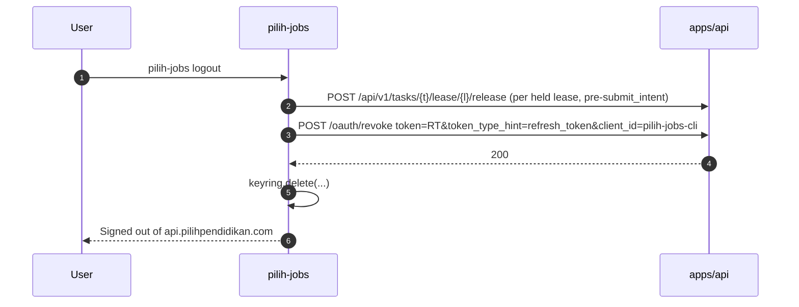

# 17 — OAuth 2.0 + PKCE Authentication (CLI ↔ apps/api)

How the `pilih-jobs` CLI obtains, refreshes, stores and loses credentials for the
same user identity that signs in to `apps/jobs`. The CLI authenticates against
the existing authorization server in `apps/api` (D-09). That server is extended
with refresh tokens, revocation, scopes, any-port loopback redirects,
session-aware consent and device binding. It is not replaced.

Legend: see `00-README.md` §2. Tables and columns: `04-DATABASE-SCHEMA.md` §1.

---

## 1. Current authentication inventory [VERIFIED]

All paths are relative to `apps/api/src/`.

| Capability | Where | Facts |
|---|---|---|
| Canonical identity | `auth.ts:59-61` | `normalizeEmail()` = `trim().toLowerCase()`. `Caller = {email, isAdmin, scope}` (`auth.ts:19-23`). There is no user table. |
| Bearer extraction | `auth.ts:141-150` | `Authorization: Bearer …`, falling back to the host-only session cookie. |
| Bearer resolution | `auth.ts:176-219` | SHA-256 of the bearer. KV `auth:session:<hash>` is checked first (always `write`), then the D1 `mcp_tokens` row (`status`, `revoked_at`, `expires_at` checked). |
| Secret generation | `auth.ts:105-107` | `randomSecret()`: 32 random bytes, base64url (256-bit). Used for every bearer, link, code and client secret. |
| Host cookies | `auth.ts:113-115`, `session.ts:66-74` | `__Host-<name>; HttpOnly; Secure; SameSite=Lax; Path=/` (plain `<name>` on http localhost). |
| Browser session | `session.ts:21-48` | 7-day bearer. The D1 `mcp_tokens` row (`kind='session'`) is written **before** the KV record, so sign-out always finds a row to revoke. |
| AS metadata (RFC 8414) | `oauth/discovery.ts:8-27` | `grant_types_supported: ["authorization_code"]`, `code_challenge_methods_supported: ["S256"]`, `scopes_supported: ["mcp"]`, `authorization_response_iss_parameter_supported: true`. |
| Protected-resource metadata (RFC 9728) | `oauth/discovery.ts:31-39` | `resource: "<issuer>/"`, `bearer_methods_supported: ["header"]`. |
| Dynamic client registration (RFC 7591) | `oauth/register.ts:53-128` | Public clients (`none`) are allowed. Redirect URIs must be https, or http **only on loopback** (`oauth/shared.ts:85-99`). |
| Authorization endpoint | `oauth/authorize.ts:72-99`, `131-144` | Requires `response_type=code`, **`code_challenge_method=S256`** and a challenge matching `^[A-Za-z0-9\-._~]{43,128}$` (`shared.ts:149-154`). `state` may be up to 512 chars but is **optional**. The redirect URI must **exactly** match a registered one: `parseRedirectUris(...).includes(redirectUri)` (`authorize.ts:83`). |
| Consent | `oauth/authorize.ts:101-129`, `146-219` | The consent page always asks for an **email address** and emails a link (`auth:oauth-magic:<hash>`, TTL 900 s). The `__Host-oauth-flow` cookie binds the link to the initiating browser. |
| Magic confirmation | `oauth/magic.ts:68-139` | Same-browser and same-origin checks. Issues a code (`oauth:code:<hash>`, TTL 300 s, `shared.ts:22`) and redirects 303 with `code`, `state`, `iss`. |
| Token endpoint | `oauth/token.ts:78-136` | `authorization_code` only. Verifies the PKCE S256 verifier in constant time. The code is single-use (`consumeCode`, `token.ts:67-75`). The access token is opaque, stored as `mcp_tokens` `kind='session'`, `scope='write'`, **90 days** (`shared.ts:26`). It returns `scope: "mcp"`. |
| Personal tokens | `personal-tokens.ts:86-117` | `/connect` mints `write` or `read` tokens that never expire. Revocation is via `/auth/tokens/:id/revoke`. |
| Rate limits | `rate-limit.ts:101-128` | `magic-ip` 5/15 min, `magic-email` 3/h, `oauth-register` 10/h/IP, `exchange` 30/min/IP (also `/oauth/token`). |

---

## 2. Gap analysis

| Requirement | Exists? | Evidence / note | Work |
|---|---|---|---|
| Authorization endpoint | ✓ | `oauth/authorize.ts` | Extend (session-aware consent, scopes, device name) |
| Token endpoint | ✓ | `oauth/token.ts` | Add `refresh_token` grant; issue scoped 1 h tokens to the CLI client |
| PKCE S256 (plain rejected) | ✓ | `authorize.ts:89-94`, `token.ts:116-118` | Keep |
| Consent | ✓ (email-link only) | `authorize.ts:101-129` | Keep as the fallback |
| **Session-aware consent** (skip email when already signed in at `api.`) | ✗ | `authorize.ts` never reads `__Host-session` | **[NEW]** §4.3 |
| **RFC 8252 any-port loopback** | ✗ | exact match at `authorize.ts:83` | **[NEW]** §4.2 |
| **Refresh tokens + rotation + reuse detection** | ✗ | `shared.ts:24-26` "There is no refresh grant" | **[NEW]** §7 |
| **Revocation endpoint (RFC 7009)** | ✗ | revocation only via `/connect` / `/auth/tokens` | **[NEW]** §8 |
| **Scopes** (validated, bound to code, enforced) | ✗ | `scope` read but ignored (`authorize.ts:28-48`); every token gets `write` | **[NEW]** §5 |
| **Device registration and binding** | ✗ | no `devices` table | **[NEW]** §6 (D-10) |
| **First-party pre-registered client** | ✗ | only DCR clients | **[NEW]** §3 |
| **`state` required** | ✗ (optional) | `magic.ts:121-123` sets it only if present | **[NEW]** required for `pilih-jobs-cli` (CLI always sends it) |
| **Stable user id in tokens** | ✗ | tokens carry `user_email` | **[NEW]** `users.id` (D-03), `mcp_tokens.user_id` |
| Device authorization grant (RFC 8628) | ✗ | none | Deferred to M8 (§10.2) |
| DPoP (RFC 9449) | ✗ | none | Deferred to M8 (§11) |
| OIDC / ID tokens | ✗ | none | Not needed: `GET /api/v1/me` returns identity |

---

## 3. Decision D-09 and client registration

### 3.1 D-09: extend the hand-rolled server

**[DECISION D-09]** Extend `apps/api/src/oauth/*` rather than migrate to
`@cloudflare/workers-oauth-provider`.

| Criterion | Extend existing (chosen) | Migrate to `@cloudflare/workers-oauth-provider` 1.2.3 |
|---|---|---|
| Standards coverage | We add refresh rotation, RFC 7009 revocation and scopes ourselves (≈ 600 LOC + tests) | Built in: OAuth 2.1, PKCE S256 only, rotation, RFC 7009, DCR, CIMD, RFC 8252 loopback port handling [VERIFIED] https://github.com/cloudflare/workers-oauth-provider |
| Token storage | D1 `mcp_tokens` (listable on `/connect`, revocable, auditable with SQL) | `OAUTH_KV` with token format `{userId}:{grantId}:{secret}`, `props` encrypted per token [VERIFIED] storage-schema.md |
| Existing MCP connections | Untouched | All existing OAuth tokens (D1 rows) become invalid unless a dual-resolver bridge is written; MCP users must reconnect |
| `/connect` "active sessions" list | Keeps working (`connect.ts:136-149`) | Must be rewritten against the library's grant listing API |
| Scope enforcement | Ours (the library also does **not** enforce scopes: "advertised but not enforced") | Same work either way |
| Device grant / DPoP | Not present | Not present (no RFC 8628; DPoP "fail closed until … implemented") |
| Router fit | Native to the hand-written router (`app.ts`) | The library wants to own the fetch handler (`apiHandler`/`defaultHandler`), so dispatch must be restructured |
| Risk | Self-implemented crypto-adjacent logic. Mitigated by reusing `randomSecret`, `hashToken` and `timingSafeEqual`, plus the RFC test vectors in §13 | Library maturity, plus a migration of live credentials |

**When to revisit:** if a third grant type (device grant or token exchange) or
DPoP is needed, or if the custom code passes ~1,500 LOC. Re-evaluate the library
then, with a dual-read bridge (library first, D1 fallback for 90 days).

### 3.2 Pre-registered first-party client

**[NEW]** A seed migration inserts the client (`DB` migration `0003_seed_cli_client.sql`):

| Column | Value |
|---|---|
| `client_id` | `pilih-jobs-cli` |
| `client_secret_hash` | `''` (public client: no secret is embedded in the CLI) |
| `client_name` | `pilih-jobs CLI` |
| `redirect_uris` | `["http://127.0.0.1/callback", "http://[::1]/callback"]` |
| `token_endpoint_auth_method` | `none` |
| `first_party` | `1` |
| `allowed_scopes` | `jobs:read jobs:write discovery:write automation:execute automation:manage cv:read cv:write files:read files:write ai:invoke devices:manage offline_access` |
| `loopback_any_port` | `1` |

DCR (`/oauth/register`) must refuse a `client_id` starting with `pilih-`.
`first_party` and `allowed_scopes` can only be set by migrations. DCR clients get
`allowed_scopes = 'mcp'`, which maps to the legacy `write` behaviour, so
existing MCP clients are unchanged.

---

## 4. Authorization request handling (changes to `oauth/authorize.ts`)

### 4.1 Request parameters (CLI → `/oauth/authorize`)

```text
GET https://api.pilihpendidikan.com/oauth/authorize
  ?response_type=code
  &client_id=pilih-jobs-cli
  &redirect_uri=http://127.0.0.1:53127/callback
  &code_challenge=<BASE64URL(SHA256(verifier)), 43 chars>
  &code_challenge_method=S256
  &state=<base64url(32 random bytes), 43 chars>
  &scope=jobs:read jobs:write discovery:write automation:execute cv:read files:read files:write ai:invoke offline_access
  &device_name=<url-encoded, ≤ 60 chars, default "<hostname> (macOS)">
```

- **Verifier:** 64 characters from the RFC 7636 unreserved set, drawn from
  `secrets.token_urlsafe(48)` (64 base64url characters). The existing
  `PKCE_VERIFIER_RE` in `token.ts` accepts 43–128.
- **State:** `secrets.token_urlsafe(32)`. **[NEW]** For first-party clients,
  `state` is required (≥ 22 chars). The server rejects a missing state with an
  error page.
- **`device_name`:** a non-standard extension parameter, shown on consent and
  escaped. It carries no authority; the device record is created later (§6).

### 4.2 RFC 8252 loopback port matching [NEW]

```ts
// shared.ts
function redirectMatches(client: OAuthClientRow, requested: string): boolean {
  const registered = parseRedirectUris(client.redirect_uris);
  if (registered.includes(requested)) return true;                // exact (unchanged behaviour)
  if (!client.loopback_any_port) return false;
  const r = new URL(requested);
  if (r.protocol !== "http:" || !(r.hostname === "127.0.0.1" || r.hostname === "[::1]")) return false;
  if (r.search || r.hash || r.username || r.password) return false;
  return registered.some((u) => { const g = new URL(u);
    return g.hostname === r.hostname && g.pathname === r.pathname && g.port === ""; });
}
```

- Port wildcarding applies only to IP-literal loopback hosts (`localhost` is
  NOT RECOMMENDED, RFC 8252 §8.3) and only for clients flagged
  `loopback_any_port`.
- The path must match exactly (`/callback`).
- Both `/oauth/authorize` and `/oauth/token` use `redirectMatches` for the
  first check. At token time the comparison is still **exact equality with the
  `redirect_uri` stored with the code**, which keeps RFC 6749 §4.1.3
  semantics.

### 4.3 Session-aware consent [NEW]

`GET /oauth/authorize` reads the `__Host-session` cookie (host-only on
`api.pilihpendidikan.com`, `session.ts:66-74`) through `resolveBearer`. It then
renders one of two pages.

| Condition | Page |
|---|---|
| Valid browser session (KV `auth:session:*`) **and** the client is `first_party` | **Approve page**: "Allow **pilih-jobs CLI** on **<device_name>** to …" with the human-readable scope list, the signed-in email, a "Not you? Sign out" link, and *Approve* / *Deny* buttons. The form POSTs to `/oauth/authorize/decision`. |
| No session, or the client is third-party (DCR) | The existing email form (`authorize.ts:101-129`), unchanged. After the magic-link confirmation (`magic.ts`) the **same approve page** is shown before the code is issued, for first-party clients only. |

`POST /oauth/authorize/decision` **[NEW]**:

1. `isSameOriginPost` (`http.ts:57-63`).
2. A **consent CSRF token** must match: a hidden field equal to
   `HMAC(session_hash, authorize_params_hash)`, issued with the GET page and
   valid for 10 min.
3. Re-validate every parameter (§4.1).
4. On *Deny*, 303 to `redirect_uri?error=access_denied&state=…&iss=…`.
5. On *Approve*:
   - create an `oauth_grants` row (`device_id` NULL; scopes = requested ∩ `allowed_scopes`);
   - store the code in KV `oauth:code:<hash>`: `{user_id, email, clientId, redirectUri, codeChallenge, grantId, scopes}`, TTL 300 s;
   - 303 to `redirect_uri?code=…&state=…&iss=https://api.pilihpendidikan.com`.

The page sets `frame-ancestors 'none'` and `X-Frame-Options: DENY`
(`html.ts:91-111`), so consent cannot be clickjacked.

---

## 5. Scope model

### 5.1 Scope list

Scopes are defined in 05 §1.2. The CLI requests a **base set** at login and
**step-up scopes** on demand.

| CLI command family | Scopes needed | Requested at |
|---|---|---|
| `whoami`, `list`, `show`, `status`, `sync` (pull) | `jobs:read` | login (base) |
| `discover`, `sync` (push) | `discovery:write jobs:write` | login (base) |
| `score` | `jobs:write` | login (base) |
| `cv generate` / `cv download` / `cv review --approve\|--reject` | `cv:read cv:write files:read ai:invoke` | login (base; `cv:write` asked by step-up on first use) |
| `apply`, `worker start` | `automation:execute files:read files:write ai:invoke` | login (base) |
| `apply --approve`, approving from the CLI, enabling rules | `automation:manage` | **step-up**: `pilih-jobs login --scope automation:manage` re-runs consent with the **same device** |
| `devices list/revoke` from the CLI | `devices:manage` | step-up |
| Refresh | `offline_access` | login (base) |

Base login scopes:
`jobs:read jobs:write discovery:write automation:execute cv:read files:read files:write ai:invoke offline_access`.

**[DECISION]** `automation:manage` is not in the CLI base set. A stolen CLI
token can then execute tasks the user created, but cannot create submission
approvals for itself or enable `auto` rules. Interactive approval in the CLI
(`apply --approve`) needs the step-up scope, which shows its own consent page.

### 5.2 Enforcement

- `Caller.scopes: string[]` is resolved from `mcp_tokens.scopes`. Legacy rows
  (`scopes IS NULL`) map as in 05 §1.2.
- Each `/api/v1` handler declares `requiredScope`. The router checks it before
  the handler runs and answers `403 insufficient_scope` with `scope` in the
  body plus `WWW-Authenticate: Bearer error="insufficient_scope", scope="<needed>"`.
- `automation:execute` additionally requires `Caller.deviceId` to be set, the
  device to be unrevoked, and (for lease routes) the lease to belong to that
  device (21 §5).
- The `/mcp` endpoint keeps the existing `write`/`read` filter
  (`mcp-tools.ts:22-39`). A CLI token presented to `/mcp` is treated as `read`
  unless it has `jobs:write`.

---

## 6. Device registration (D-10)

The flow, after the token exchange:

1. The CLI calls `POST /api/v1/devices` with
   `{name, platform, arch, cli_version, capabilities[], public_key?}`, using
   the new access token. The token belongs to a grant with `device_id IS NULL`.
2. The server inserts a `devices` row, sets `oauth_grants.device_id`, and sets
   `mcp_tokens.device_id` on every live access token of the grant, all in one
   `batch()`.
3. It returns `201 {device: {id, name, …}}`.
4. A second registration on the same grant returns `409 duplicate`.
5. Until a device is registered, the access token's
   `automation:execute` scope is **inert**: lease routes return
   `403 device_required`.
6. Re-login on the same machine reuses the stored `device_id`. The CLI sends
   `device_id` in the authorize request (`&device_hint=dev_…`). If that device
   is owned by the user and not revoked, the server binds the new grant to it
   and revokes the old grant's family (`revoked_reason='user'`). This prevents
   device sprawl.
7. `public_key` (Ed25519) is optional in v1 and reserved for DPoP (§11).

Revocation is covered in §9.

---

## 7. Token lifecycle

### 7.1 Lifetimes

| Token | Lifetime | Storage (server) | Storage (CLI) |
|---|---|---|---|
| Authorization code | 300 s, single use | KV `oauth:code:<sha256>` (existing) | memory only |
| Access token (`pilih-jobs-cli`) | **1 h** | `mcp_tokens` (`kind='oauth'`, `scopes`, `grant_id`, `device_id`, `user_id`) | memory, plus a keyring cache (§12) |
| Refresh token | **Idle 30 d**, **absolute 90 d** from grant creation, rotated on every use | `oauth_refresh_tokens` (hash only) | OS keyring |
| Access tokens of DCR/MCP clients | 90 d (unchanged, `shared.ts:26`) | `mcp_tokens` `kind='session'` | n/a |

Every token is opaque (`randomSecret()`, 256-bit). Only SHA-256 hashes are
stored, which is the existing rule (`apps/api/CLAUDE.md`).

### 7.2 Token endpoint changes (`oauth/token.ts`)

- `grant_type=authorization_code` for `pilih-jobs-cli`:
  - returns `{access_token, token_type:"Bearer", expires_in:3600, refresh_token, scope:"<granted>"}`;
  - `refresh_token` is present only if `offline_access` was granted;
  - also returns `Cache-Control: no-store` (keeping the existing `Pragma`).
- `grant_type=refresh_token` **[NEW]**: form `refresh_token`, `client_id`, and
  optionally `scope` (must be a subset; it narrows the access token only). The
  server:
  1. Hashes the token and finds the row. If it is missing, revoked or past
     `expires_at`, or its grant is revoked: `invalid_grant`.
  2. If `used_at` is NULL, this is the normal path:
     - set `used_at = now`;
     - insert a new refresh row (`parent_id` = this row,
       `expires_at = min(grant.created_at + 90 d, now + 30 d)`);
     - insert a new access-token row;
     - all in one `batch()`. Return both tokens.
  3. **Grace rule**, mirroring workers-oauth-provider: a token whose `used_at`
     is set stays acceptable **only while its child has never been used**
     (child `used_at IS NULL`).
     - In that window the server re-issues the *same* child refresh token
       (stored encrypted for 60 s in KV `oauth:rft-grace:<parent_hash>`) and a
       new access token. This covers the CLI crashing before it persisted the
       new token.
     - After 60 s, or once the child has been used, a presentation is
       **reuse**: go to step 4.
  4. **Reuse detected:**
     - revoke the whole family: `oauth_grants.revoked_at`,
       `revoked_reason='refresh_reuse'`, all refresh rows, and all
       `mcp_tokens` with that `grant_id`;
     - fail live leases of the device (as for device revocation, 21 §10);
     - write an audit event;
     - return `invalid_grant`;
     - the dashboard shows "Device signed out — suspicious token reuse".
- Rate limit: the existing `exchange` rule (30/min/IP) plus a new
  `refresh-grant` rule of 10/min per grant.

### 7.3 Refresh sequence

```mermaid
sequenceDiagram
  autonumber
  participant CLI as pilih-jobs (httpx)
  participant KR as OS keyring
  participant API as apps/api /oauth/token
  participant DB as D1 (DB)
  CLI->>API: GET /api/v1/... (Bearer AT1)
  API-->>CLI: 401 invalid_token (expired_token)
  CLI->>KR: read refresh token RT1
  CLI->>API: POST /oauth/token grant_type=refresh_token&refresh_token=RT1&client_id=pilih-jobs-cli
  API->>DB: SELECT refresh row by sha256(RT1)
  alt RT1 unused and valid
    API->>DB: batch{ RT1.used_at=now; INSERT RT2(parent=RT1); INSERT AT2 }
    API-->>CLI: 200 {access_token: AT2, refresh_token: RT2, expires_in: 3600}
    CLI->>KR: write RT2 (replace RT1)
    CLI->>API: retry original request with AT2
  else RT1 used, child RT2 unused, within 60 s
    API-->>CLI: 200 {access_token: AT2', refresh_token: RT2 (same), ...}
  else RT1 used and (RT2 used or > 60 s)  [reuse]
    API->>DB: batch{ revoke grant, all refresh rows, all access tokens of grant }
    API-->>CLI: 400 invalid_grant
    CLI->>KR: delete credentials
    CLI-->>CLI: "Signed out: refresh token reuse detected. Run pilih-jobs login."
  end
```

The CLI serializes refreshes behind a **process-wide file lock**
(`<data>/auth.lock`), so the worker and an interactive command never refresh
concurrently. The lock is the most common cause of false reuse.

---

## 8. Logout and revocation (RFC 7009) [NEW]

`POST /oauth/revoke` (form `token`, optional `token_type_hint`, `client_id`):

- Public client: `client_id` is required and must match the token's grant.
- Revoking a refresh token revokes the **whole grant** (family plus access tokens).
- Revoking an access token revokes only that row.
- It always answers `200` for unknown or already-revoked tokens (RFC 7009 §2.2).
- It sits behind the public CORS policy (as `/oauth/*` does today) and the
  `exchange` rate limit.

`pilih-jobs logout`:

1. Release held leases that are before `submit_intent` (21 §6).
2. Flush the outbox, with a confirmation prompt if it is not empty
   (`--discard-outbox` to skip).
3. `POST /oauth/revoke` with the refresh token. The server sets
   `devices.revoked_at` only when the user passes `--forget-device`; otherwise
   the device stays registered with no live grant.
4. Delete the keyring entries.
5. Keep browser profiles. They are local and are never uploaded.



---

## 9. Device revocation from the web

```mermaid
sequenceDiagram
  autonumber
  participant W as apps/jobs (BFF)
  participant API as apps/api
  participant DB as D1 DB + JOBS_DB
  participant CLI as pilih-jobs on revoked device
  W->>API: POST /api/v1/devices/dev_X/revoke (scope devices:manage)
  API->>DB: batch(DB){ devices.revoked_at; oauth_grants.revoked_at (reason device_revoked); refresh rows revoked; mcp_tokens revoked }
  API->>DB: batch(JOBS_DB){ leases of dev_X: submit_intent? -> outcome_unknown : queued; attempts.outcome=lease_expired; events }
  API-->>W: 200 {device}
  CLI->>API: any call with AT
  API-->>CLI: 401 invalid_token (revoked_token)
  CLI->>API: POST /oauth/token grant_type=refresh_token
  API-->>CLI: 400 invalid_grant
  CLI->>CLI: stop browser executor immediately, delete keyring creds, keep outbox (marked orphaned)
```

Effects are immediate for every request, because the access-token lookup reads
the D1 row. **[LIMITATION]** A request already in flight completes. Lease
fencing (21 §5) stops any further progress reports.

---

## 10. Login flows

### 10.1 Happy path: `pilih-jobs login`

```mermaid
sequenceDiagram
  autonumber
  actor U as User
  participant CLI as pilih-jobs
  participant L as Loopback listener 127.0.0.1:{ephemeral}
  participant B as System browser
  participant API as apps/api (/oauth/*)
  participant KV as AUTH_KV
  participant DB as D1 DB
  participant KR as OS keyring
  U->>CLI: pilih-jobs login
  CLI->>API: GET /.well-known/oauth-authorization-server (RFC 8414; cached 24 h)
  CLI->>CLI: verifier = token_urlsafe(48) (64 chars); challenge = b64url(sha256(verifier)); state = token_urlsafe(32)
  CLI->>L: bind 127.0.0.1:0 (OS-assigned port), one-shot, timeout 300 s
  CLI->>B: webbrowser.open(authorize URL with redirect_uri=http://127.0.0.1:{port}/callback)
  CLI-->>U: "Opening browser… If nothing opens, visit: <URL>"
  B->>API: GET /oauth/authorize?... (cookie __Host-session if signed in)
  alt signed in at api.pilihpendidikan.com
    API-->>B: Approve page (device name, scopes, signed-in email, CSRF token)
  else not signed in
    API-->>B: Email form (existing)
    B->>API: POST /oauth/authorize (email)
    API->>KV: auth:oauth-magic:<hash> (900 s) + Set-Cookie __Host-oauth-flow
    U->>B: open emailed link in the same browser
    B->>API: GET/POST /oauth/magic (flow cookie verified)
    API-->>B: Approve page
  end
  U->>B: Approve
  B->>API: POST /oauth/authorize/decision (same-origin + CSRF)
  API->>DB: INSERT oauth_grants (user_id, client, scopes, device_id NULL)
  API->>KV: oauth:code:<hash> {user_id, grantId, scopes, challenge, redirectUri} (300 s)
  API-->>B: 303 http://127.0.0.1:{port}/callback?code=…&state=…&iss=https://api.pilihpendidikan.com
  B->>L: GET /callback?code&state&iss
  L->>L: check path == /callback, state == expected (constant-time), iss == issuer
  L-->>B: static "You can close this tab" page (no scripts, no external assets)
  L->>CLI: code (listener closes)
  CLI->>API: POST /oauth/token grant_type=authorization_code, code, code_verifier, redirect_uri, client_id
  API->>KV: consume code (single use)
  API->>DB: batch{ INSERT mcp_tokens(kind oauth, scopes, grant_id, user_id, 1 h); INSERT oauth_refresh_tokens }
  API-->>CLI: {access_token, refresh_token, expires_in: 3600, scope}
  CLI->>API: POST /api/v1/devices {name, platform, arch, cli_version, capabilities}
  API->>DB: batch{ INSERT devices; UPDATE oauth_grants.device_id; UPDATE mcp_tokens.device_id }
  API-->>CLI: 201 {device}
  CLI->>KR: store {refresh_token, device_id, user_id, scopes, issuer}
  CLI->>API: GET /api/v1/me
  CLI-->>U: "Signed in as alice@example.com on device 'alice-mbp (macOS)'"
```

Failure handling:

| Failure | CLI behaviour |
|---|---|
| Browser cannot be opened (`webbrowser.open` returns False, or `$BROWSER` is unset on Linux without a display) | Print the URL. Keep the listener alive for 300 s. |
| Listener timeout (300 s) | Exit 2 with "Login timed out". Nothing is stored. |
| `state` mismatch, `iss` mismatch, unexpected path, or a second request | Respond 400 to the browser and ignore. Abort only on a state mismatch (log `state_mismatch`, no values). |
| `error=access_denied` | Exit 1 with "Authorization was denied". |
| Token exchange `invalid_grant` | Exit 1, suggest retry. The code is single-use, so never retry silently. |
| Device registration fails | Revoke the just-issued refresh token (`/oauth/revoke`) and exit 1, so no orphan grant is left behind. |

### 10.2 Headless and SSH login

**v1:** `pilih-jobs login --no-browser` prints the authorize URL and listens on
`127.0.0.1:<port>` **of the remote host**, with the port fixed by `--port` for
predictability. The user forwards the port from their workstation:

```bash
ssh -L 53127:127.0.0.1:53127 user@server   # then, on the server:
pilih-jobs login --no-browser --port 53127  # open the printed URL on the workstation
```

The browser's redirect to `http://127.0.0.1:53127/callback` reaches the server
through the tunnel. **[LIMITATION]** Without port forwarding the loopback flow
cannot complete on a remote machine. Copy-paste of the code (OOB) is not
offered, because the `urn:ietf:wg:oauth:2.0:oob` pattern is deprecated and
weakens code interception protection.

**M8: RFC 8628 device authorization grant** (design sketch, deferred,
[ASSUMPTION]: only if headless servers become a real use case):
- `POST /oauth/device_authorization` returns `{device_code, user_code (8 chars, BCDFGHJKLMNPQRSTVWXZ, shown as XXXX-XXXX), verification_uri: https://api.pilihpendidikan.com/device, expires_in: 600, interval: 5}`.
- The token endpoint accepts `grant_type=urn:ietf:params:oauth:grant-type:device_code` and returns `authorization_pending` / `slow_down` (+5 s) / `access_denied` / `expired_token`.
- Phishing mitigations (RFC 8628 §5.4):
  - The verification page must show the device name, IP-derived country, the requested scopes and a warning: "Only continue if you just ran pilih-jobs login on a device you control".
  - `automation:execute` is **not** grantable via the device grant without a second confirmation email.
  - User codes are single-use, rate-limited 5 attempts/min per session, and expire in 10 min.

---

## 11. Sender-constrained tokens (deferred)

**[ASSUMPTION]** For v1, refresh **rotation with reuse detection** satisfies
RFC 9700 §2.2.2 for public clients [VERIFIED]
https://www.rfc-editor.org/rfc/rfc9700.html.

**M8:** DPoP (RFC 9449), using the device Ed25519 key registered in
`devices.public_key`:
- the access token response uses `token_type: DPoP`;
- `DPoP` proof headers carry `htm`, `htu`, `iat`, `jti` and `ath`;
- server nonces are sent via `DPoP-Nonce`;
- `jti` replay cache in KV for 5 min.

This binds stolen tokens to the keypair held in the OS keyring.

---

## 12. CLI credential storage

| Item | Location | Notes |
|---|---|---|
| Refresh token | `keyring` service `pilih-jobs`, account `<api-host>:<user_id>:refresh` | e.g. `api.pilihpendidikan.com:usr_01J…:refresh` |
| Access token (cache) | `keyring` same service, account `<api-host>:<user_id>:access` (JSON `{token, expires_at, scopes}`) | Optional cache so a new process avoids a refresh. Discarded within 60 s of expiry. |
| Device private key (M8) | `keyring` account `<api-host>:<user_id>:device-key` | Not created in v1 |
| Non-secret metadata | `<config>/credentials.json` (mode 0600): `{issuer, user_id, email, device_id, device_name, scopes, active_profile}` | Used to find keyring entries. Contains no secrets. |

- **Backends** [VERIFIED] https://pypi.org/project/keyring/: macOS Keychain,
  Windows Credential Locker, Linux Secret Service (or KWallet).
- **Headless Linux without a Secret Service:** `login` refuses with a helpful
  message unless the user passes `--credential-store encrypted-file` (the same
  setting as `pilih-jobs config set credentials.store encrypted-file`, 16 §9).
  That stores a file encrypted with a passphrase (key derived with stdlib
  `hashlib.scrypt`, n=2^17, r=8, p=1, then AES-GCM), and the passphrase is prompted once per process or
  read from `PILIH_JOBS_KEYRING_PASSPHRASE`.
- **Plaintext storage is never offered.**
- `PYTHON_KEYRING_BACKEND=keyring.backends.null.Keyring` causes login to refuse
  rather than silently drop credentials.
- **Multiple accounts and environments:** `--api-url https://api.pilihpendidikan.com` (env `PILIH_JOBS_API_URL`)
  (default) or `http://localhost:8788` (dev; http allowed **only** for
  loopback). Each issuer has separate keyring accounts.

### 12.1 Personal tokens in the CLI

`PILIH_JOBS_TOKEN=<personal token from /connect>` is accepted for scripting.

- **[DECISION]** Such a credential is used **only** for commands needing
  `jobs:read` / `jobs:write` / `discovery:write`, following the legacy mapping
  in 05 §1.2.
- `automation:execute` and `ai:invoke` are refused by the server.
- The CLI refuses `apply`, `worker start`, `cv generate` and
  `browser`-driven work with a message to run `pilih-jobs login`.
- Personal tokens are never written to disk by the CLI.

---

## 13. Security requirements checklist

| Requirement | Standard | How it is met |
|---|---|---|
| Use the system browser, not an embedded webview | RFC 8252 §6, §8.12 | `webbrowser.open()`. The CLI never embeds a browser for login, and **the Playwright automation browser is never used for OAuth**. |
| Loopback redirect on an IP literal, any port | RFC 8252 §7.3, §8.3 | `127.0.0.1` (or `[::1]`). Port wildcard via `loopback_any_port` (§4.2). |
| Listener binds loopback only | RFC 8252 §8.3 | Socket bound to `127.0.0.1`, never `0.0.0.0`. One request is accepted, then the socket closes. 300 s timeout. |
| Exact path | RFC 6749 §3.1.2 | `/callback` must match. Anything else gets a 404 and is ignored. |
| PKCE S256, plain rejected | RFC 7636, RFC 9700 §2.1.1 | Existing enforcement (`authorize.ts:89-94`). Verifier is 64 chars. |
| `state` CSRF protection | RFC 6749 §10.12 | 256-bit state, compared in constant time. Required for first-party clients. |
| Mix-up defence | RFC 9207 | The CLI checks `iss` against metadata (`authorization_response_iss_parameter_supported: true` today). |
| No client secret in the binary | RFC 8252 §8.5 | `token_endpoint_auth_method = none`. |
| Refresh-token protection for public clients | RFC 9700 §2.2.2 | Rotation and family revocation on reuse (§7.2). DPoP in M8. |
| Short-lived access tokens | RFC 9700 §4.14 | 1 h. |
| Least privilege | RFC 9700 §2.3 | Scope ceiling per client, base set plus step-up, server enforcement. |
| Revocation | RFC 7009 | `/oauth/revoke` (§8), device revocation (§9). |
| Metadata | RFC 8414 | `discovery.ts` gains `grant_types_supported: ["authorization_code","refresh_token"]`, `revocation_endpoint`, `revocation_endpoint_auth_methods_supported: ["none","client_secret_basic","client_secret_post"]`, `scopes_supported` (all §5 scopes + `mcp`). The protected-resource metadata `scopes_supported` is updated to match. |
| Codes single-use and short | RFC 6749 §4.1.2 | Existing (`consumeCode`, 300 s). |
| No credentials in logs | — | CLI log redaction filter: `Authorization`, `refresh_token`, `access_token`, `code`, `code_verifier` and `state` values are replaced by `sha256[:8]`. Server never logs bearers (existing rule). `httpx` event hooks log URLs with the query string stripped on `/oauth/*`. |
| No browser cookie extraction | brief §4 | The CLI never reads browser cookie stores or profile databases for authentication. Login uses only the OAuth redirect. |
| Consent clickjacking / CSRF | — | `frame-ancestors 'none'`, `X-Frame-Options: DENY`, same-origin POST plus an HMAC CSRF token (§4.3). |

---

## 14. Threat model (authentication)

| # | Threat | Vector | Mitigation | Residual risk |
|---|---|---|---|---|
| T1 | Stolen refresh token | Malware reading the keyring, a backup leak | OS keyring ACLs. Rotation means a stolen token races the legitimate CLI, and the first reuse revokes the family. Device revocation from the web. Absolute 90 d expiry. M8 DPoP. | Malware with user privileges can act until detected. **[LIMITATION]** Inherent to public clients. |
| T2 | Malicious local process on the loopback port | Another process races to bind the port, or receives the redirect | Ephemeral OS-assigned port. PKCE: an intercepted code is useless without the verifier, which stays in CLI memory. `state` check. | A same-user process that can read CLI memory defeats this; out of scope. |
| T3 | Authorization code interception | Browser history, a referrer, a URL-sniffing extension | PKCE S256. 300 s single use. The callback page loads no external resources (no referrer leak). | Low |
| T4 | Consent phishing | An attacker sends the victim an authorize link for **their** loopback | The redirect goes to the victim's own `127.0.0.1`, so the attacker never receives the code. The approve page shows device name and scopes plus "only approve if you just ran pilih-jobs login". `first_party` cannot be registered via DCR. | Low |
| T5 | CSRF on consent | A cross-site form posting an approval | Same-origin check (`http.ts:57-63`). HMAC CSRF token bound to the session and the parameters. SameSite=Lax session cookie. | Low |
| T6 | Email magic-link interception | An attacker obtains the emailed link | Existing browser binding (`__Host-oauth-flow`, `magic.ts`). 15 min TTL. | Low |
| T7 | Scope escalation | A CLI token calls manage-level APIs | Server-side scope checks. `automation:manage` only via explicit step-up consent. | Low |
| T8 | Token leakage via logs or crash reports | Debug logs, stack traces | Redaction filter. Crash reports never include headers. Tests assert redaction (§15). | Low |
| T9 | Downgrade to a personal token | Using a never-expiring PAT for automation | PATs cannot hold `automation:execute` / `ai:invoke` (05 §1.2). | Low |
| T10 | Revoked device keeps working | Cached access token | Every request re-reads D1 (`auth.ts:199-212`). Lease fencing. | ≤ duration of one in-flight request |

---

## 15. Test plan

**Server (`bun test`, `apps/api`, real SQLite D1 and fake KV per `test/fakes.ts`)**

1. Authorize:
   - loopback any-port accepted for `pilih-jobs-cli`;
   - rejected for a DCR client;
   - `localhost` host rejected;
   - path mismatch rejected;
   - query string on the redirect rejected;
   - missing `state` rejected for a first-party client;
   - an unknown scope is dropped, and scopes above the client ceiling are clipped.
2. Session-aware consent:
   - with a valid `__Host-session`, the approve page renders and no email is sent;
   - without one, the email form renders;
   - decision POST without the CSRF token returns 403;
   - cross-origin POST returns 403;
   - Deny redirects with `error=access_denied` and `state`.
3. Token:
   - code is single-use;
   - wrong verifier gives `invalid_grant`;
   - `redirect_uri` not equal to the stored one gives `invalid_grant`;
   - the response includes `refresh_token` only with `offline_access`;
   - access `expires_in = 3600`.
4. Refresh:
   - normal rotation;
   - grace re-issue within 60 s returns the same child;
   - reuse after the child is used revokes the grant, all access tokens and the device's leases;
   - absolute and idle expiry;
   - scope narrowing.
5. Revocation:
   - RFC 7009 returns 200 for unknown tokens;
   - revoking a refresh token kills the family;
   - revoking an access token leaves the refresh token intact;
   - a `client_id` mismatch is ignored, returning 200 but not revoking.
6. Devices:
   - registration binds the grant;
   - double registration returns 409;
   - `device_hint` rebinding revokes the old grant;
   - web revoke returns 401 on the next call and leases become `outcome_unknown`/`queued` per 21.
7. Scopes:
   - every `/api/v1` route has a declared scope (a route-table test fails if one is missing);
   - a PAT is denied `automation:execute` and `ai:invoke`.
8. Metadata:
   - the `discovery.ts` JSON matches the implemented grants;
   - snapshot test.

**CLI (pytest)**

9. PKCE: verifier length 64 and charset; the challenge matches RFC 7636 Appendix B test vectors.
10. Loopback listener:
    - binds `127.0.0.1` only (asserts `getsockname`);
    - one-shot;
    - 300 s timeout (with a fake clock);
    - rejects a wrong path or state;
    - the HTML response has no external URLs.
11. Keyring:
    - fake backend round trip;
    - null backend makes `login` refuse;
    - `encrypted-file` requires a passphrase;
    - nothing is written in plaintext (scan the config dir for token patterns after login).
12. Refresh concurrency: two processes refreshing at once are serialized by `auth.lock`, so exactly one network refresh happens.
13. Log redaction: golden logs contain no token or code values.

**End to end (staging, 13 §5):**
14. A real browser (Playwright, scripted as the *user*) completes `pilih-jobs login` against `wrangler dev`.
15. Revoke from the web, then the CLI stops within one request.
16. An SSH-forwarded login on a Linux container.
