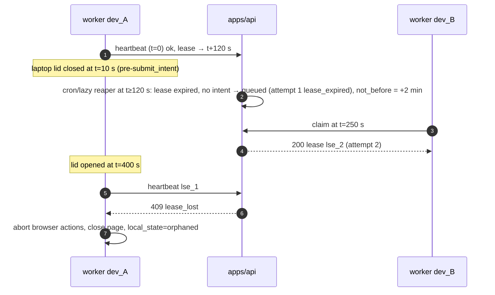
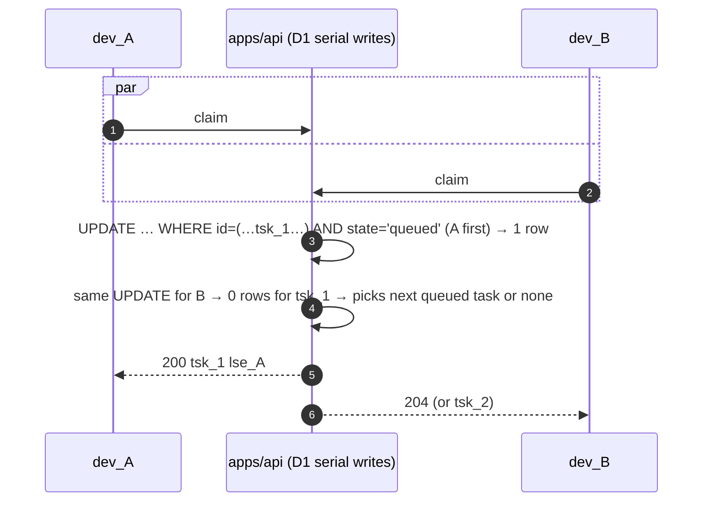

# 21 — Automation Execution Protocol (Remote → Local)

How work requested in `apps/jobs` (or by rules, MCP, or the CLI itself)
reaches an authenticated local `pilih-jobs` worker. It covers how the task is
claimed exactly once, how it is kept alive, cancelled, paused for approval and
recovered, and how the result is reported. Cloudflare never launches anything
on the user's machine: **the CLI always initiates the connection** (brief §9).

Legend: see `00-README.md` §2. Tables: `04-DATABASE-SCHEMA.md` §2.6.
Endpoints: `05-API-SPECIFICATION.md` §3 and §8. Task states: `03-DOMAIN-MODEL.md` §7.

---

## 1. Transport decision: polling vs. WebSockets (D-11)

| Criterion | HTTPS polling + D1 leases (chosen) | WebSocket per device (Durable Object) |
|---|---|---|
| Cloudflare components | Existing Worker + D1 | New DO class per user (SQLite-backed), hibernation API, plus D1 (still authoritative) |
| Pickup latency | Active: ≤ 5 s (+jitter); idle: ≤ 30–60 s | ≤ 1 s |
| Does latency matter? | Applications take 1–15 min; a ≤ 5 s start delay while the user is watching is acceptable | Marginal benefit |
| Robustness | Stateless requests; works through corporate proxies, captive portals and sleep/wake; retries are trivial | Reconnect, backoff and missed-message replay logic needed; sleeping laptops drop sockets |
| Consistency | One source of truth (D1 row + lease) | Two paths (socket message + D1). Messages are only "doorbells", so the D1 claim protocol is needed anyway |
| Request volume (1 device online 8 h/day) | Idle at 30 s ≈ 960 polls/day ≈ 29k/month; active bursts at 5 s add ~1k/day | ~1 connection + DO duration (hibernation makes idle cheap) |
| Cost at 1,000 active devices | ~30–60 M requests/month: inside or near Workers Paid included requests. D1 reads per poll: 1 indexed range read (`ix_tasks_claim`) ≈ 1–3 rows → ≤ 0.2 B rows/month, well inside the 25 B included [VERIFIED] https://developers.cloudflare.com/d1/platform/pricing/ | DO requests $0.15/M after 1 M; incoming WebSocket messages billed 20:1 [VERIFIED] https://developers.cloudflare.com/durable-objects/platform/pricing/ — similar order of magnitude, more code |
| Implementation size | ~1 route family | DO class, auth handshake, fan-out from every write path |

**[DECISION D-11]** Use HTTPS polling with adaptive intervals and atomic D1
leases. **M8 option:** a per-user `UserEventsHub` DO using WebSocket
hibernation that broadcasts `change_log.seq` "doorbells" to the dashboard and
CLIs. It only shortens poll latency; it never carries task data or grants
leases. Adopt it when p95 pickup latency complaints appear or polling exceeds
100 M requests/month.

### 1.1 Poll interval (server-guided)

The CLI worker computes its interval, and the server may override it through
`poll_interval_ms` (heartbeat and claim responses):

| Condition | Interval |
|---|---|
| A task was created for this user in the last 5 min, or an `apps/jobs` session is viewing an automation page (the BFF refreshes a KV key `jobs:watch:<user_id>` in `AUTH_KV` with a 300 s TTL; no D1 write) | 5 s |
| Otherwise | 30 s |
| No work claimed for 1 h | 60 s |
| `204` + `Retry-After` / 429 | Obey |

±20 % jitter is applied. The interval is never below 2 s.

---

## 2. Actors

```text
┌──────────────┐  create/cancel/approve  ┌──────────────────────┐  claim/heartbeat/events/result  ┌────────────────────┐
│ apps/jobs    │ ──────────────────────▶ │ apps/api (/api/v1)   │ ◀────────────────────────────── │ pilih-jobs worker  │
│ (BFF)        │ ◀── poll task status ── │  JOBS_DB (tasks,     │ ── 200 task+lease / 204 ──────▶ │ (device dev_…)     │
└──────────────┘                         │  attempts, approvals)│                                 │  ├ executor (18/19)│
┌──────────────┐  rule match / MCP tool  │  cron reaper */5 min │                                 │  ├ outbox (20)     │
│ rules engine │ ──────────────────────▶ │                      │                                 │  └ state.db        │
│ MCP clients  │                         └──────────────────────┘                                 └────────────────────┘
└──────────────┘
```

---

## 3. Worker registration and eligibility

- A device becomes a worker after `pilih-jobs login` (17 §6) registers it with
  `capabilities`. Allowed capability values:

  | Capability | Meaning |
  |---|---|
  | `discover` | Scrapling is installed |
  | `apply` | A Playwright Chromium or Chrome channel is available |
  | `render_cv` | Chromium is available |
  | `headed_browser` | A display is available, so the device can run `assisted` mode and take human handoffs |

  Capabilities are re-sent on every heartbeat (`browser install` may add some).
- The user controls eligibility with `devices.accepts_tasks` (web Devices page,
  or `pilih-jobs worker enable/disable`, which toggles it via `PATCH`; 16 §3).
- A device may claim only if **all** of these hold:
  1. the token is valid with `automation:execute` and has `device_id`;
  2. `devices.revoked_at IS NULL`;
  3. `accepts_tasks = 1`;
  4. `cli_version ≥ min_cli_version`;
  5. the task's `required_capabilities ⊆ device capabilities`;
  6. `target_device_id` is NULL or equals this device.
- **Concurrency per device:** one `apply` task at a time (a single browser
  executor), plus up to one `discover` and one `render_cv` in parallel.
  `max` in the claim request is always 1; the CLI claims again when a slot
  frees.

---

## 4. Task creation paths

| Path | Endpoint | Validation (server) | `created_by` |
|---|---|---|---|
| Web "Apply with CLI" / "Run discovery now" | `POST /api/v1/tasks` | Scope `automation:manage`; application owned; mode ∈ {`assisted`,`approval`,`auto`}; for `auto`, an enabled rule with an approved `rule_activation` covers it; at least one eligible device exists (else `422 policy_violation` "no eligible device", unless `queue_without_device=true`) | `web` |
| CLI `pilih-jobs apply <app>` | `POST /api/v1/tasks` with `target_device_id = self`, then an immediate claim | Same, except the scope: base `automation:execute` suffices for `assisted`/`approval` tasks targeted at the calling device (D-29, 05 §8). `--mode auto`, `--approve` (deciding the submit approval in the CLI) and remote-targeted tasks need step-up `automation:manage` (17 §5.1) | `cli` |
| Automation rule match (server, after scoring) | Internal service | Rule enabled; daily and per-company limits; `allowed_domains` contains `posting.apply_domain`; posting `application_support = browser_supported`; app stage `ready` (or `saved` with `cv_policy.tailor`, which first creates a CV variant) | `rule` |
| CV render fallback | Internal, when a variant has no PDF 2 min after generation and no web session rendered it (08) | Device with `render_cv` | `system` |

**Duplicate prevention at creation:**
- The `Idempotency-Key` is stored in `automation_tasks.idempotency_key`
  (unique per user).
- The partial unique index `ux_tasks_live_apply` allows at most one live
  `apply` task per application (04 §2.6). A second create returns
  `409 duplicate` with the existing task id.

---

## 5. Claim, lease, heartbeat, fencing

### 5.1 Claim

`POST /api/v1/devices/{dev_id}/tasks:claim` `{capabilities, max: 1}` with an
`Idempotency-Key` of `claim:<dev_id>:<ULID>`.

1. Authorize as in §3.
2. **Lazy reaping:** run the reaper (§7) scoped to this user, so a dead
   device's tasks become claimable without waiting for cron.
3. Run the atomic claim `UPDATE … RETURNING` from 04 §3.
   - `lease_id = "lse_" + ULID`
   - `lease_expires_at = now + 120 s`
4. **In the same `batch()`:**
   - insert `automation_attempts` (`attempt_no = attempt_count`, `lease_id`,
     `device_id`, `cli_version`);
   - append `application_events` `automation_task_claimed`;
   - append `change_log`.
5. Return `200 {task, lease: {lease_id, expires_at, heartbeat_interval_ms: 30000}, context}`
   or `204`. `context` contains:
   - for `apply`: application, posting, the CV variant file id + sha256, mode,
     rule limits, allowed domains, the approval policy, and the latest
     `form_hash` approvals if resuming;
   - for `discover`: source ids;
   - for `render_cv`: `cv_variant_id` and a render ticket.

D1 executes writes serially [VERIFIED]
https://developers.cloudflare.com/d1/worker-api/d1-database/ (batch statements
"execute and commit, sequentially, non-concurrently"). Two concurrent claims
therefore cannot both match `state = 'queued'` for the same row; the loser's
`UPDATE` affects 0 rows and it receives `204`, or the next task.

### 5.2 Heartbeat

`POST /api/v1/tasks/{tsk}/lease/{lse}/heartbeat` every **30 s**, with body
`{progress: {stage, step, message, percent?}, local_state}`:

```sql
UPDATE automation_tasks
SET lease_expires_at = :now + 120000, progress = :progress, local_state = :local_state,
    state = CASE WHEN state = 'claimed' THEN 'running' ELSE state END,
    revision = revision + 1, updated_at = :now
WHERE id = :tsk AND user_id = :uid AND lease_id = :lse AND lease_device_id = :dev
  AND state IN ('claimed','running','paused','awaiting_approval') AND lease_expires_at > :now
RETURNING state, cancel_requested, lease_expires_at;
```

- 0 rows → `409 lease_lost`.
- The response is `{lease_expires_at, cancel_requested, poll_interval_ms, server_time}`.
- `automation_attempts.last_heartbeat_at` is updated in the same batch.
- To limit D1 write load, `change_log` is appended only when `state` or
  `progress.stage` changes, not on every heartbeat.

### 5.3 Fencing rules (CLI side)

The `lease_id` is a fencing token.

1. Every lease-scoped call carries `lease_id` in the path. The server checks
   `lease_id`, `lease_device_id`, the unexpired lease and a non-terminal state.
2. **On `409 lease_lost` the executor must stop acting in the browser
   immediately.** It aborts the current Playwright action, closes the page
   without submitting, marks `local_tasks.local_state = 'orphaned'` and never
   reports again under that lease. Evidence already captured after an
   acknowledged `submit_intent` follows the late-evidence path (20 §6.3 A).
3. **Local deadline:** if no successful heartbeat for 90 s (monotonic clock;
   3 missed beats), the executor pauses all browser actions. At 110 s it
   treats the lease as lost, even before the server confirms. The 10 s safety
   margin is under the 120 s server lease.
4. Heartbeats run as a separate **asyncio task** on the CLI's single event
   loop (16 §13), with their own HTTP client, not the outbox flusher queue.
   The heartbeat task never touches the browser (Playwright async API, one
   loop); it only sets an `asyncio.Event` that the executor checks between
   actions (18 §6).

### 5.4 Lease timings

| Parameter | Value |
|---|---|
| Lease length | 120 s from the last heartbeat |
| Heartbeat interval | 30 s (the server can change it via `heartbeat_interval_ms`) |
| CLI local pause / lost threshold | 90 s / 110 s without a successful heartbeat |
| Device "online" / "active" | `last_seen_at` ≤ 6 min (written at most once per 5 min) / lease heartbeat ≤ 90 s (04 §1) |
| Approval wait | Lease kept alive by heartbeats while `awaiting_approval` (≤ 24 h approval expiry). After 30 min waiting, the CLI may **release** the browser (pre-`submit_intent`) and keep the task in `awaiting_approval` with no lease (§6.4). |
| Attempt wall timeout | 15 min (19 limits) |
| Queued task expiry | 72 h (`expires_at`) |

---

## 6. Progress, pause, approval, submit intent, result

### 6.1 Progress events

`POST /tasks/{t}/lease/{l}/events`, batched ≤ 50 events or every 5 s. Event types:

| Type | Server effect |
|---|---|
| `started` | `state: claimed → running` |
| `progress` | `progress` updated (stage ∈ `preparing_cv`, `opening`, `inspecting`, `filling`, `uploading`, `reviewing`, `submitting`, `verifying`) |
| `log` | Appended only to the attempt's step log file. Redacted, uploaded at the end (`run_log`), never stored in D1 |
| `paused` | `state → paused`; `pause_reason` set to one canonical PauseReason value (03 §7.2), e.g. `login_required`, `captcha_or_challenge`, `mfa_required`, `unknown_question`, `unsupported_form`, `off_domain_navigation`, `user_requested`, `network_offline`, `ai_unavailable` |
| `resumed` | `paused → running` |
| `approval_requested` | Use the dedicated approvals route (§6.3) |
| `submit_intent` | **Not** sent through this batched route; see §6.5 |

Each event appends an `application_events` row (`automation_task_progress` /
`_paused`), deduplicated by `idempotency_key`.

### 6.2 Pause for human input

- **Headed mode** (`assisted`, or a device with `headed_browser`): the CLI
  brings the browser window to the front. It prints a terminal prompt (and an
  OS notification when available), for example "Login required on
  boards.greenhouse.io — complete it in the browser window, then press Enter
  (or type `skip`)".
- While paused, heartbeats continue. The dashboard shows "Paused on device
  <name>: login required".
- **Headless worker** with no human present: the task pauses for at most
  10 min. Then the CLI **releases** the lease (pre-`submit_intent` only) with
  `outcome = paused` and `retry_hint = needs_headed`. The task returns to
  `queued` with `required_capabilities += ["headed_browser"]`, so a device
  with a display picks it up. The user is notified.
- **The agent never solves or bypasses** CAPTCHAs, challenges, MFA or logins
  (18 §8, brief §5).

### 6.3 Approvals across devices

```mermaid
sequenceDiagram
  autonumber
  participant CLI as pilih-jobs worker (dev_A)
  participant API as apps/api
  participant W as apps/jobs (user on phone/laptop)
  CLI->>CLI: form filled; reached final review step; compute form_hash
  CLI->>API: POST /tasks/T/lease/L/approvals {kind: submit, payload, payload_hash=form_hash}
  API-->>CLI: 201 {approval: apr_1, expires_at}
  API->>API: task.state = awaiting_approval; event approval_requested
  par CLI waits
    loop every 5 s (and heartbeat every 30 s)
      CLI->>API: GET /tasks/T/lease/L/approvals/apr_1
      API-->>CLI: {state: pending}
    end
  and user decides on web
    W->>API: GET /api/v1/approvals?state=pending
    W->>API: POST /api/v1/approvals/apr_1/decide {decision: approve, payload_hash}
    API->>API: UPDATE approvals SET state='approved' WHERE id=apr_1 AND state='pending' AND payload_hash=?
  end
  CLI->>API: GET .../approvals/apr_1
  API-->>CLI: {state: approved}
  CLI->>CLI: recompute form_hash; must equal payload_hash (else new approval)
  CLI->>API: POST /tasks/T/lease/L/submit-intent {form_hash, approval_id}
  API-->>CLI: 200 {submit_intent_at}
  CLI->>CLI: click Submit; verify (19 §9)
  CLI->>API: POST /tasks/T/lease/L/result {outcome: submitted, evidence, application_update}
```

- The decision can come from any surface: the web Approval queue, the CLI
  prompt on the same device (`pilih-jobs` shows `[a]pprove/[r]eject/[o]pen`
  inline when interactive and holding `automation:manage`), or MCP
  (`jobs_approval_decide`). First decision wins (20 §6.2).
- **Rejected** → the CLI closes the page without submitting and reports
  `outcome = cancelled` (`reason = approval_rejected`). The application stays
  at stage `ready` with `submission_status = not_started`.
- **Expired** (24 h) → same as rejected (`reason = approval_expired`).
- `answer` approvals (an unknown or protected screening question) follow the
  same flow. The user's response (`approvals.response`) is used for this
  application only. It is saved to the answer bank only if the user ticks
  "save for future" (never `always` for `protected`; 03 §9).

### 6.4 Releasing the browser while awaiting approval

If an approval stays pending for more than 30 min, the CLI may release to
free the browser slot:

- `POST …/release {reason: awaiting_approval}` → `lease_id` cleared, state
  stays `awaiting_approval`.
- When the user approves later, the server returns the task to `queued` with
  `payload.resume_from_approval = apr_1`.
- The next claimant re-runs the fill flow. If the recomputed `form_hash`
  equals the approved `payload_hash`, it proceeds without a new approval; any
  difference means a new approval.

### 6.5 The `submit_intent` checkpoint (D-19)

`POST /api/v1/tasks/{t}/lease/{l}/submit-intent` `{form_hash, approval_id?, rule_id?}`
— a **[NEW]** dedicated route, added to 05 §8.

- Server preconditions, checked in one statement plus a batch:
  - the lease is valid;
  - the task is not cancelled;
  - the application is still owned, not `withdrawn`/`rejected`/`accepted`, and
    `submission_status ∉ {submitted_verified, submitted_unverified}` (no double
    submission);
  - mode `approval` → an `approved` approval whose `payload_hash = form_hash`;
  - mode `auto` → the rule is still enabled, the daily and per-company limits
    are not exceeded (counted from `submit_intent` events in the last 24 h /
    30 d), and the domain is allowlisted;
  - mode `assisted` → this route is not used; the human clicks Submit
    themselves, and the CLI records a `submission_status_changed` event with
    `payload.via = "assisted_user_click"` (03 §6) and then verifies.
- Effects:
  - `submit_intent_at = now`;
  - `applications.submission_status = in_progress`;
  - an event `submit_intent`.
- **The CLI may click the final Submit only after a `200` from this route**,
  which is synchronous and never queued in the outbox. With no connectivity
  the executor waits until the lease's local deadline, then abandons without
  submitting.
- After `submit_intent_at` is set, nothing ever re-runs this task
  automatically. A lost lease means `outcome_unknown` (§7).

### 6.6 Result

`POST …/result` `{outcome, error_class?, retryable?, evidence?, application_update?, log_file_id?, stats}`:

| `outcome` | Task state | Application effect |
|---|---|---|
| `submitted` | `submitted` | Evidence row. `submission_status` = `submitted_verified` / `submitted_unverified` (19 §9). Stage `ready → applied` per the precedence rule (20 §6.2). `submitted_at`, `submission_method = browser` |
| `succeeded` (discover / render_cv) | `succeeded` | Run or variant linkage |
| `failed` | `failed` (or `queued` if retryable and attempts remain; §8) | `submission_status` → `failed` only if `submit_intent` happened and evidence is `negative`; otherwise unchanged (`not_started`) |
| `cancelled` | `cancelled` | None (or approval-rejection event) |
| `outcome_unknown` | `outcome_unknown` | `submission_status = outcome_unknown` (e.g. crash recovery after `submit_intent`, or verification timed out) |

The attempt row is closed (`ended_at`, `outcome`, `steps_count`, `ai_calls`,
`log_file_id`), and the lease fields are cleared.

---

## 7. Offline detection and lease expiry

### 7.1 Reaper

The reaper runs in two places:
- **cron** `*/5 * * * *` (a new trigger in `apps/api/wrangler.jsonc`, next to
  the existing daily `0 3 * * *` [VERIFIED] `apps/api/wrangler.jsonc:103-106`);
- **lazily** at the start of every claim, for that user.

```sql
-- tasks whose lease expired
SELECT id, kind, submit_intent_at, attempt_count, max_attempts, lease_id
FROM automation_tasks
WHERE state IN ('claimed','running','paused','awaiting_approval')
  AND lease_id IS NOT NULL AND lease_expires_at <= :now
LIMIT 200;
```

Per task, in one `batch()`, conditioned on `lease_id = :old_lease`:

| Condition | New state | Notes |
|---|---|---|
| `submit_intent_at IS NOT NULL` | `outcome_unknown` | D-19. App `submission_status = outcome_unknown`. Notify the user: "Check your email/ATS for a confirmation, then mark Applied or Not submitted." |
| `state = 'awaiting_approval'` (no intent) | stays `awaiting_approval`, lease cleared | Resumes after the decision (§6.4) |
| `attempt_count < max_attempts` | `queued` (`not_before = now + backoff`) | Attempt outcome `lease_expired` |
| else | `failed` (`error_class = lease_expired`) | |

Other reaper work:
- queued tasks past `expires_at` become `expired`;
- pending approvals past `expires_at` become `expired`, with the task
  cancelled per §6.3.

### 7.2 Device offline display

The dashboard marks a device offline when `last_seen_at` is older than 6 min
(04 §1). A task whose lease has had no heartbeat for 90 s shows "Device offline — will retry when the lease expires
(≤ 2 min)".

---

## 8. Retry policy

| `error_class` | Retryable? | Notes |
|---|---|---|
| `network_offline`, `upstream_unavailable` (AI), `browser_crashed`, `lease_expired` (pre-intent) | yes | backoff `not_before = now + 2^(attempt) min` (2, 4 min) |
| `timeout` (15 min attempt wall) | yes, once | then `failed` |
| `page_changed`, `selector_not_found` | yes, once | the second attempt uses a fresh observation |
| `login_required`, `captcha_or_challenge`, `mfa_required` | no automatic retry | re-queued only with `headed_browser`, or the user resumes (§6.2) |
| `unsupported_form`, `prohibited_platform`, `domain_not_allowed`, `policy_violation` | no | `failed`; the user is informed with the reason |
| `validation_errors_unresolved` | no | the form rejected values; the user must fix facts or answers |
| `posting_closed` | no | `failed`; the card shows "posting closed" |
| `approval_rejected`, `approval_expired`, `cancelled` | n/a | `cancelled` |
| any error **after `submit_intent`** | **never** | `outcome_unknown` or `failed` by evidence (§6.6) |

`max_attempts = 3` (default). `POST /tasks/{id}/retry` from the user is allowed
from `failed`, and from `outcome_unknown` **only after the user confirms
nothing was submitted** (`confirm_not_submitted: true`, recorded as an event).
It creates a new task with a new idempotency key; the old task stays terminal.

---

## 9. Duplicate execution prevention (defence in depth)

| Layer | Mechanism |
|---|---|
| Creation | `UNIQUE (user_id, idempotency_key)`; `ux_tasks_live_apply` (≤ 1 live apply per application) |
| Claim | Atomic conditional `UPDATE … WHERE state='queued' … RETURNING` (one winner) |
| Execution | Lease fencing: every report needs the current `lease_id` and device; a stale holder gets `409 lease_lost` and must stop (§5.3) |
| Submission | `submit-intent` refuses when the application is already submitted, or when another task holds the intent; it is synchronous |
| Local | Lock file `<data>/locks/app_<id>.lock` (OS advisory lock), so two processes on one machine (e.g. a worker plus an interactive `apply`) never drive the same application; plus one browser executor per profile (profile lock, 18 §3) |
| Post-hoc | Lease expiry after intent → `outcome_unknown`, never re-queued |
| Cross-device | Claims are per user and serialized by D1; `target_device_id` pins interactive runs to the requesting device |

---

## 10. Device revocation effects

`POST /api/v1/devices/{dev}/revoke` (17 §9), in one batch:

- Credentials: grant, refresh family and access tokens revoked; `devices.revoked_at`.
- Live leases held by the device:
  - `submit_intent_at` set → `outcome_unknown`;
  - `awaiting_approval` → lease cleared, approval kept;
  - otherwise → `queued` (attempt `lease_expired`), excluding the revoked
    device by setting `target_device_id = NULL`.
- Tasks pinned with `target_device_id = dev` and still `queued` → `cancelled`
  (`reason = device_revoked`) unless the user re-targets them.
- The revoked CLI receives `401 invalid_token` with `reason: revoked_token`
  on its next call (05 §1.3; `403 device_revoked` is only for other valid
  credentials addressing the revoked device). The executor stops at once:
  `401 revoked_token` on a heartbeat is treated exactly like `lease_lost`.

---

## 11. Authorization at every step

| Step | Checks |
|---|---|
| Create task | Scope `automation:manage` (or the internal rule engine); application `user_id = caller.userId`; mode and rule policy |
| Claim | `automation:execute`; `caller.deviceId = path dev_id`; device not revoked and `accepts_tasks`; claim query filters `user_id = caller.userId` |
| Heartbeat / events / approvals / result | Path task `user_id = caller.userId` **and** `lease_device_id = caller.deviceId` **and** `lease_id` matches (404 for another user's task, never 403, consistent with jobs today) |
| Submit intent | All of the above plus §6.5 policy |
| Decide approval | `automation:manage`; approval `user_id`; `payload_hash` match |
| AI proxy calls during an attempt | `ai:invoke`; `lease_ref = {task_id, lease_id}` must be a live lease of this device (05 §9) |
| File download (CV) | `files:read`; file `user_id`; the CLI verifies sha256 against the claim `context` |

---

## 12. Task state machine — transition table

| From | To | Trigger | Actor | Preconditions | Side effects / events |
|---|---|---|---|---|---|
| — | `queued` | create | web/cli/rule/system (MCP cannot create tasks in v1) | §4 validation | `automation_task_created` event; app `mode` set |
| `queued` | `claimed` | claim | device | §3 eligibility; `not_before ≤ now < expires_at` | attempt row; `_claimed` event |
| `queued` | `cancelled` | cancel | user | — | `_finished` event (`cancelled`) |
| `queued` | `expired` | reaper | system | `expires_at ≤ now` | event; notify |
| `claimed` | `running` | first heartbeat / `started` | device | valid lease | — |
| `claimed` | `queued` | lease expiry | reaper | no intent; attempts remain | attempt `lease_expired` |
| `running` | `paused` | `paused` event | device | valid lease | `_paused` event; dashboard notice |
| `paused` | `running` | `resumed` | device | valid lease | event |
| `running` | `awaiting_approval` | create approval | device | valid lease; mode `approval` or `answer` gate | `approval_requested` event |
| `awaiting_approval` | `running` | approved (+ CLI observes) | user → device | payload_hash match | `approval_decided` event |
| `awaiting_approval` | `queued` | approved after release (§6.4) | user | task released | `resume_from_approval` |
| `awaiting_approval` | `cancelled` | rejected / expired | user / reaper | — | app unchanged |
| `running`/`paused` | `queued` | release (pre-intent) or retryable failure | device | attempts remain; no intent | attempt closed; backoff |
| `running` | `submitted` | result `submitted` | device | intent recorded; valid lease | evidence; app update (20 §6.2) |
| `running` | `succeeded` | result `succeeded` | device | kind ≠ apply | run/variant linkage |
| `running`/`paused` | `failed` | result `failed` (non-retryable or attempts exhausted) | device / reaper | — | app submission per §6.6 |
| any live | `outcome_unknown` | lease expiry / revoke after intent; result `outcome_unknown` | reaper / device | `submit_intent_at` set | app `submission_status = outcome_unknown`; notify |
| `outcome_unknown` | `submitted` | late evidence via `POST /api/v1/tasks/{t}/attempts/{a}/late-evidence` (05 §8, 20 §6.3 A) | system | evidence from this task's attempt | evidence row; conflict check |
| `outcome_unknown` | `failed` | user "Not submitted" | user | — | `submission_status = failed` (user deny) |
| `failed`/`outcome_unknown` | (new task) | retry | user | §8 (`confirm_not_submitted: true` from `outcome_unknown`) | new task with `retry_of` (04 §2.6) |
| running states | (cancel requested) | cancel | user | — | flag delivered by heartbeat; the CLI aborts before the next action; if past intent, cancel is **ignored** for the submit, but the CLI stops after verification |

---

## 13. Sequences

### 13.1 Happy path: web → CLI apply (approval mode)

```mermaid
sequenceDiagram
  autonumber
  actor U as User (web)
  participant W as apps/jobs BFF
  participant API as apps/api
  participant D1 as JOBS_DB
  participant CLI as pilih-jobs worker (dev_A)
  participant BR as Local Chromium
  U->>W: "Apply with CLI" on app_1
  W->>API: POST /api/v1/tasks {kind: apply, application_id: app_1, mode: approval, idempotency_key}
  API->>D1: INSERT automation_tasks (queued) + event + change_log
  API-->>W: 201 {task: tsk_1}
  loop every 5 s (active)
    CLI->>API: POST /devices/dev_A/tasks:claim
  end
  API->>D1: atomic claim → lease lse_1 (120 s); attempt att_1
  API-->>CLI: 200 {task, lease, context}
  CLI->>API: GET /files/{cv}/content (verify sha256)
  CLI->>BR: launch persistent context, open apply_url
  par heartbeats
    CLI->>API: heartbeat every 30 s (progress)
  and agent loop (19)
    CLI->>API: /api/v1/ai/* (lease_ref)
    CLI->>BR: validated actions (fill, upload, next)
  end
  CLI->>API: approval (§6.3) … approved on web
  CLI->>API: POST …/submit-intent {form_hash}
  API-->>CLI: 200
  CLI->>BR: click Submit
  CLI->>API: /ai/verify-submission
  CLI->>API: POST /files (screenshot, run_log)
  CLI->>API: POST …/result {outcome: submitted, evidence, application_update}
  API->>D1: batch{ task submitted; attempt closed; evidence; app stage applied (precedence ok); events; change_log }
  W->>API: GET /api/v1/tasks/tsk_1 (poll 2 s)
  W-->>U: Card moves to Applied ✓ Verified
```

### 13.2 Lease loss mid-run (laptop sleeps)



### 13.3 Cancellation

```mermaid
sequenceDiagram
  autonumber
  participant U as User
  participant API as apps/api
  participant CLI as worker
  U->>API: POST /tasks/tsk_1/cancel
  alt task queued
    API-->>U: 200 {state: cancelled}
  else task running (pre-intent)
    API->>API: cancel_requested = 1
    API-->>U: 202 {state: running, cancel_requested: true}
    CLI->>API: heartbeat
    API-->>CLI: {cancel_requested: true}
    CLI->>CLI: stop before next action; close page (no submit)
    CLI->>API: POST …/result {outcome: cancelled}
  else task past submit_intent
    API-->>U: 409 {error: "too_late", message: "Submission already in progress"}
  end
```

### 13.4 Two devices racing



Approval on the web is covered in §6.3.

---

## 14. Audit log

Everything below is retained for the life of the application (account deletion
excepted).

| Record | Contents |
|---|---|
| `automation_tasks` | Who created the task (`created_by`, actor in the creation event), mode, rule, payload, every state change (`revision`, `change_log`) |
| `automation_attempts` | Device, CLI version, lease id, start/end, heartbeats, outcome, error class, step and AI-call counts, link to the step log |
| Step log (`files` kind `run_log`, R2, 30 d) | JSONL per action: `{ts, step, observation_hash, candidates[ids], chosen_id, ai_call_ids, action, validation_result, duration_ms, url_host}`. Field **values** are redacted to `fact_key` / `answer_id` references plus `sha256[:8]`, so no PII appears in logs |
| `application_events` | Claimed, progress milestones, paused/resumed, approval requested/decided, `submit_intent` (form_hash), result, conflict |
| `approvals` | Exact payload shown, payload hash, decision, surface, timestamp |
| `submission_evidence` | Signals, final URL, excerpt, screenshot file id, form hash |
| `request_log` (existing) | MCP tool calls for `jobs_*` tools |

The user can export the full audit trail of one application as JSON from
`apps/jobs` (12) or `pilih-jobs show <app> --audit --json`.

---

## 15. Observability

Server metrics, from Workers Observability logs (`observability.enabled`
[VERIFIED] `apps/api/wrangler.jsonc:21-23`) with structured `console.log`
JSON lines, plus the `analytics_daily` rollups:

- Claim latency: `claimed_at − max(created_at, not_before)`, p50/p95, by
  `created_by`.
- Lease losses per 100 attempts; `outcome_unknown` rate (target < 0.5 %).
- Heartbeat gap histogram; reaper actions per run.
- Task outcomes by `error_class`, adapter and mode.
- Poll requests per device per hour, and the 204 ratio.
- Approval decision latency; expiry rate.

CLI: `pilih-jobs status` shows the worker state, current lease, last
heartbeat, poll interval, outbox depth and the last 10 task outcomes. Logs go
to `<logs>/pilih-jobs.log` (rotating, redacted).

Alerts, via a scheduled check in the 5 min cron, logged as `level=error` for
Workers Logs alerting:
- `outcome_unknown` > 3 in 1 h for a user (likely a CLI bug);
- the reaper finds more than 50 expired leases in one run.

---

## 16. Test plan

**Server (`bun test`, real SQLite)**
1. Claim atomicity: 50 concurrent claims for 10 queued tasks yield 10 distinct
   winners, no task claimed twice, and every attempt row unique.
2. Capability and target filtering; `accepts_tasks = 0` and revoked devices
   never claim; the CLI version gate returns 426.
3. Heartbeat fencing: a stale `lease_id`, another device, or an expired lease
   returns 409. A heartbeat converts `claimed → running` and does not append
   `change_log` unless the stage changes.
4. `submit-intent`: refused without an approval or with a mismatched hash; for
   a rejected or withdrawn application; when already submitted; after the
   rule limit is exceeded.
5. Reaper matrix (§7.1): every row of the table, including `awaiting_approval`
   release and `expires_at`.
6. Result precedence and forward-only submission status (shared with 20 §13).
7. Revocation effects (§10).
8. Cancellation: queued is immediate; running is delivered via heartbeat;
   past intent returns 409 `too_late`.
9. Isolation: every lease route with another user's ids returns 404.

**CLI (pytest)**
10. Heartbeat task: lost-lease detection at 110 s with a fake monotonic
    clock; executor aborts between actions; the heartbeat task never touches
    Playwright.
11. `submit_intent` is synchronous: with the network mocked down, Submit is
    never clicked.
12. Local application lock: a second `apply` on the same application exits
    with "already running".

**Multi-device race and chaos (staging: `wrangler dev` + 2–3 CLI containers
against a fixture ATS site, 13 §5)**
13. Three workers polling, 20 tasks: each task executes exactly once (assert on
    fixture site submission counts).
14. Kill -9 the CLI at each step (before claim ack, after claim, mid-fill,
    awaiting approval, just before `submit-intent`, just after `submit-intent`
    ack, after click before result). Expected: no double submission ever, and
    every task ends in `submitted`, `queued → completed by another device`, or
    `outcome_unknown` (only for post-intent kills).
15. Network partition (toxiproxy) for 3 min mid-run: the lease is lost and the
    executor stops; another device completes it; the original device's late
    reports get 409.
16. Clock skew ±2 h on the CLI host: leases behave correctly (server-evaluated).
17. Load: 1,000 simulated idle devices polling at 30 s for 1 h. D1 rows read
    and Worker CPU per poll stay within the budgets (14 §9).
